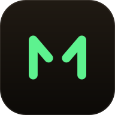

<div align="center">



# MorseForge

### Learn Morse. Build the Signal.

A free Morse code trainer that runs entirely in your browser — real CW audio, a
keyboard straight key, and a signal tree that lights up as you master each
character.

**[morse.iamcanturk.dev →](https://morse.iamcanturk.dev)**

[](https://morse.iamcanturk.dev)
[](#testing)
[](LICENSE)
[](https://astro.build)

</div>

---

## What it is

Most Morse code sites are a translator with an alphabet chart bolted on.
MorseForge is a trainer: you learn the code in the order it is actually
structured, you hear it as real CW tones, and you send it back with your own
keyboard.

No account. No ads. No server — your progress never leaves your device.

|                                                                                    |                                                                                             |
| ---------------------------------------------------------------------------------- | ------------------------------------------------------------------------------------------- |
| **[Learn it in 7 days](https://morse.iamcanturk.dev/learn-morse-code-in-7-days/)** | Two characters on day one, all 26 letters and 10 digits by day seven                        |
| **[The tree](https://morse.iamcanturk.dev/tree/)**                                 | The real binary structure of Morse, drawn as a circuit. Pick a node to hear it and drill it |
| **[Telegraph](https://morse.iamcanturk.dev/telegraph/)**                           | Your keyboard is the key. Tap for a dot, hold for a dash, decoded live                      |
| **[Translator](https://morse.iamcanturk.dev/morse-code-translator/)**              | Text ↔ Morse, with audio and a signal lamp at 5–40 WPM                                      |
| **[Alphabet](https://morse.iamcanturk.dev/morse-code-alphabet/)**                  | Every character per ITU-R M.1677-1, click to hear                                           |
| **[Words](https://morse.iamcanturk.dev/words/)**                                   | 22 words and phrases, each playable and explained                                           |

---

## Why it's built this way

A few decisions that are load-bearing, and would look arbitrary without the
reasoning.

**Characters are taught by code length, not alphabetically.** Morse is a prefix
tree — a dot branches left, a dash branches right — so the seven-day plan walks
one layer per day. That is why day one is E and T, and why Q and Z come last.

**Three skills are tracked separately.** Recognising a printed `.-`, hearing it
at speed, and keying it are different abilities that improve at different rates.
A character only reaches _Mastered_ with evidence in all three, so two hundred
perfect recognitions alone will never master it.

**Farnsworth timing is on by default.** Characters play at full speed with the
gaps stretched. Slowing the characters themselves teaches people to count
individual beeps, and that habit becomes a hard ceiling around 10 WPM.

**How patient the key is has nothing to do with WPM.** At 15 WPM a character
ends after 240 ms of silence — correct for a competent operator, hopeless for a
beginner who means to send `S` and, three seconds of hesitation later, has sent
`E E E`. Keying patience is its own setting, defaulting to 1.6 seconds, with a
manual mode that removes the clock entirely.

**Every page is prerendered to real HTML.** GPTBot, ClaudeBot and PerplexityBot
do not execute JavaScript. A client-rendered app is invisible to them, so the
whole site is static and only the interactive parts hydrate — the seven-day
plan, the blog and the word index ship **zero bytes of JavaScript**, and pages
that do load React only do so because there is genuinely something to interact
with.

**Nothing is written twice.** The alphabet is one object. The tree, the
curriculum, the word pages, the translator, `llms.txt` and every code printed
anywhere all derive from it, so a reference page cannot disagree with the
trainer.

---

## Architecture

```
src/
├── engine/        Framework-agnostic core, fully unit-tested
│   ├── timingEngine.ts    PARIS WPM + ARRL Farnsworth
│   ├── morseEncoder.ts    Text → Morse
│   ├── morseDecoder.ts    Morse → text, plus a live decoder for the key
│   ├── audioEngine.ts     Web Audio CW tone, envelope-shaped
│   └── keyEngine.ts       Straight key: short/long press, gap detection
│
├── data/          Single sources of truth
│   ├── morseAlphabet.ts   ITU-R M.1677-1
│   ├── tree.ts            Derived from the alphabet, never hand-authored
│   ├── curriculum.ts      The 7-day plan
│   └── words.ts           The word pages
│
├── game/          mastery.ts · spacedRepetition.ts
├── storage/       Versioned, validated localStorage
├── components/    React islands
├── pages/         Astro routes
└── pwa/           Build-time manifest + service worker generation
```

**Stack:** [Astro 7](https://astro.build) (static output) · React 19 islands ·
Tailwind 4 · TypeScript strict · Vitest · Web Audio API

No backend, no database, no analytics beyond anonymous, cookieless
[Cloudflare Web Analytics](https://www.cloudflare.com/web-analytics/).

---

## Running it locally

```bash
git clone https://github.com/iamcanturk/morse.git
cd morse
npm install
npm run dev
```

| Command          | Does                                                         |
| ---------------- | ------------------------------------------------------------ |
| `npm run dev`    | Dev server on :4321                                          |
| `npm run build`  | Static build to `dist/`, plus manifest and service worker    |
| `npm run verify` | Format check, type check, tests — run this before committing |
| `npm test`       | Vitest                                                       |
| `npm run deploy` | Verify, build, rsync to the server, assert the site responds |

Requires Node 20.11+.

### Testing

372 tests, covering the parts where being wrong is silent:

- **Timing** — sending PARIS once takes exactly `60/WPM` seconds, checked at
  5/12/20/35 WPM and under Farnsworth. Every speed readout depends on it.
- **Codec** — every character round-trips through encode and decode.
- **Key** — an OS auto-repeat keydown mid-hold yields one dash, not a burst
  of dots.
- **Storage** — a hand-edited export claiming more correct answers than
  attempts is clamped rather than shown as 16,000% accuracy.
- **Content** — no day of the plan can suggest a practice word containing a
  letter it has not taught yet, and factual claims made in prose on the public
  pages are asserted against the alphabet.

---

## Deployment

Static files on [CloudPanel](https://www.cloudpanel.io/) behind Cloudflare. The
nginx vhost is version-controlled in [`deploy/`](deploy/cloudpanel-vhost.conf) —
the default static template caches `sw.js` for ten years, which would pin every
returning visitor to whichever build they first loaded.

---

## Author

Built by **[Can Türk](https://iamcanturk.dev)**.

- 🌐 [iamcanturk.dev](https://iamcanturk.dev)
- 𝕏 [@iamcanturk](https://x.com/iamcanturk)
- 💻 [github.com/iamcanturk](https://github.com/iamcanturk)

If MorseForge is useful to you, a ⭐ on the repo or a link back to
[morse.iamcanturk.dev](https://morse.iamcanturk.dev) genuinely helps.

## Contributing

Issues and pull requests are welcome — see [CONTRIBUTING.md](CONTRIBUTING.md).
Good first issues are [labelled](https://github.com/iamcanturk/morse/labels/good%20first%20issue).

## Credits

Morse codes and timing follow
[ITU-R M.1677-1](https://www.itu.int/rec/R-REC-M.1677/en), the ITU
recommendation defining International Morse code. Farnsworth timing follows the
ARRL standard.

## License

[MIT](LICENSE) © Can Türk
