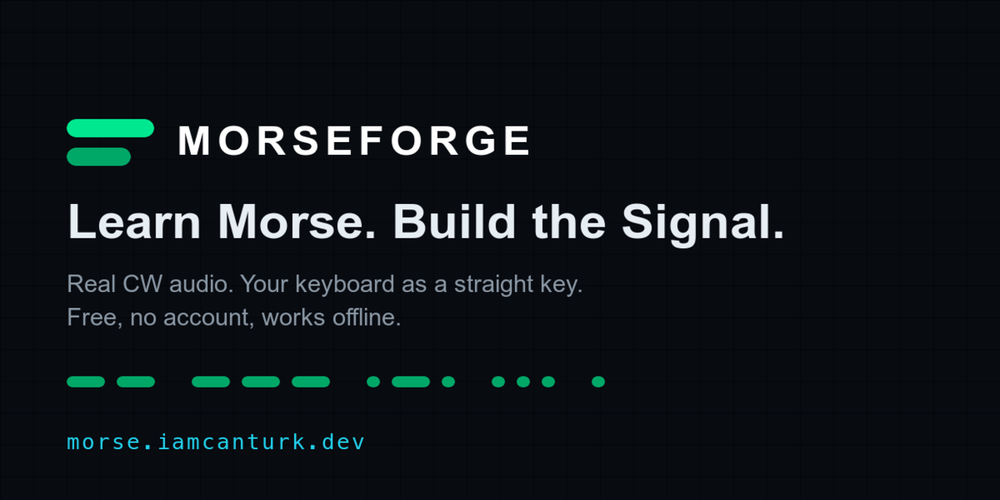
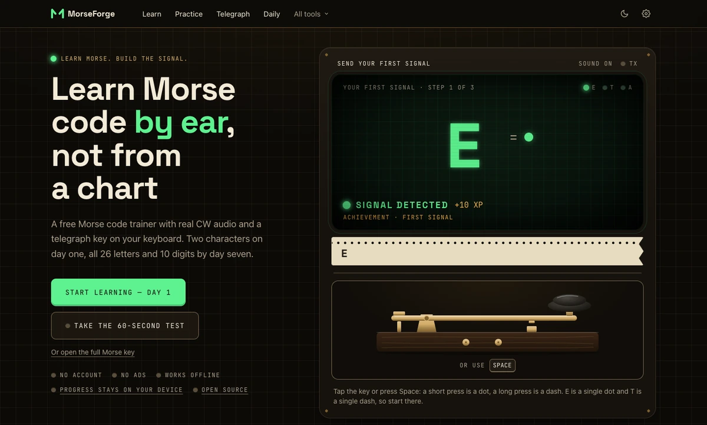
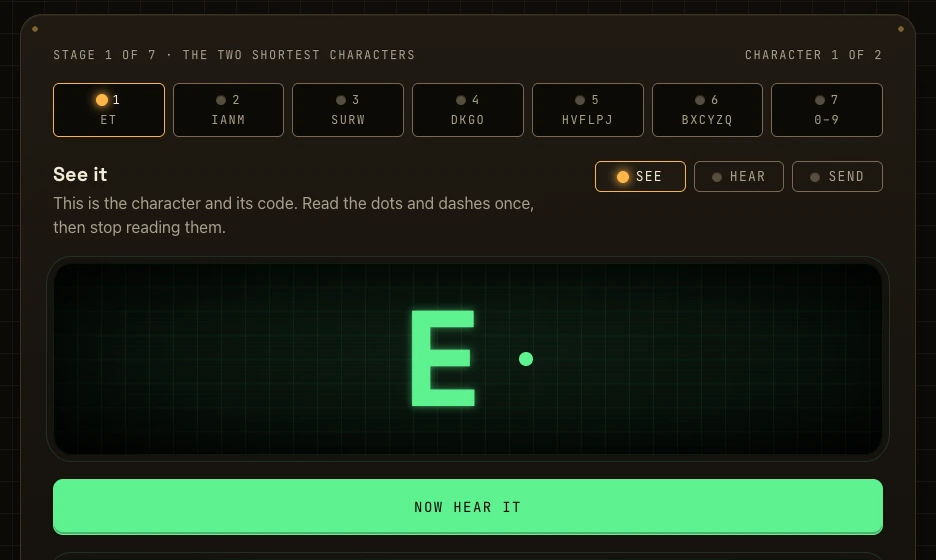
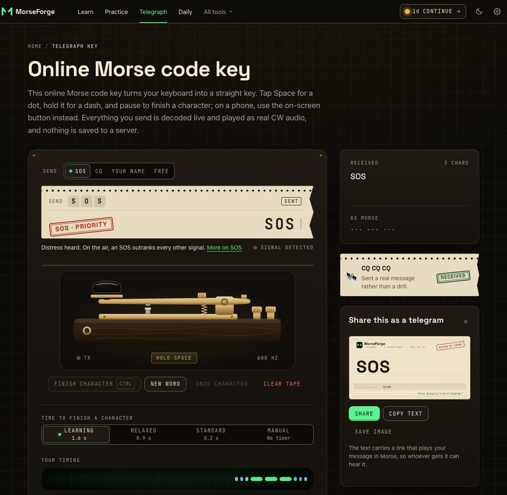
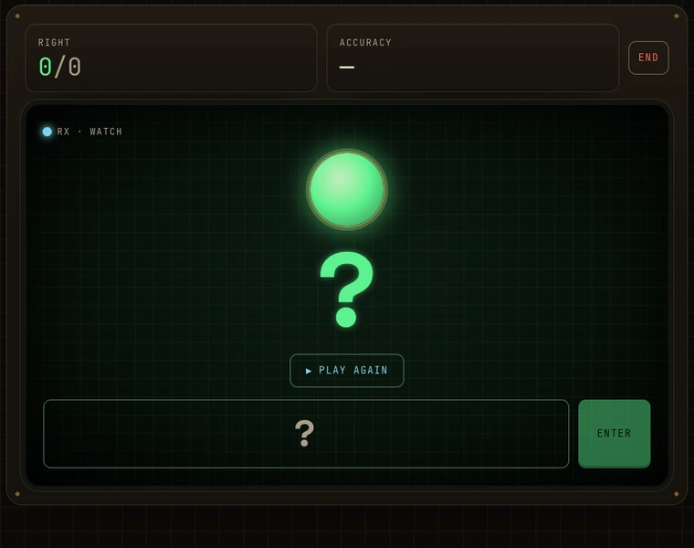
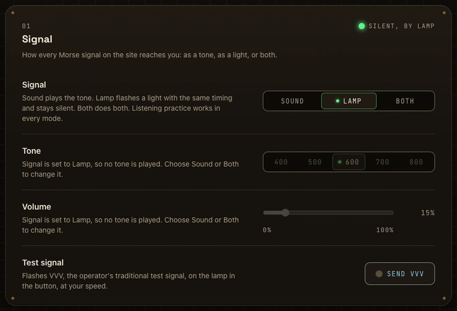
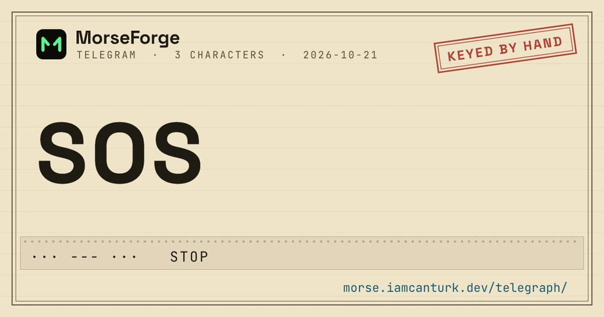
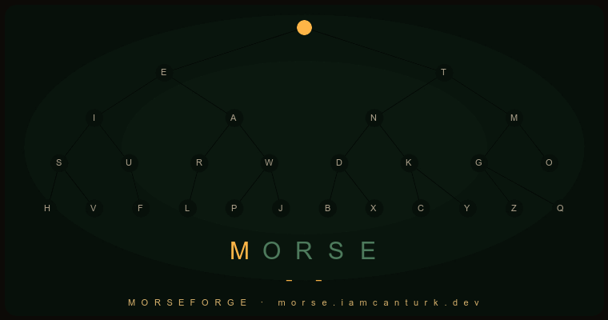

<div align="center">

<a href="https://morse.iamcanturk.dev">
  
</a>

### Learn Morse. Build the Signal.

A free Morse code trainer that runs entirely in your browser — real CW audio, a
brass telegraph key on your keyboard, and a signal tree that lights up as you
master each character.

**[Open it →](https://morse.iamcanturk.dev)** &nbsp;·&nbsp;
[Learn in 7 days](https://morse.iamcanturk.dev/learn-morse-code-in-7-days/) &nbsp;·&nbsp;
[60-second challenge](https://morse.iamcanturk.dev/challenge/) &nbsp;·&nbsp;
[Send a secret message](https://morse.iamcanturk.dev/message/)

<!--
  How the figures on this page were measured (build of 2026-10-21, after the FIX2 wave):
    tests        npx vitest run                  -> 1936 passed, 100 files
    pages, links node scripts/check-links.mjs dist -> 9691 internal references, 88 pages
    sitemap      <loc> entries in dist/sitemap-0.xml -> 83 (the other 5 pages are noindex or private)
    words        dist/words/*/                   -> 22
    char pages   dist/morse-code-alphabet/*/     -> 36
    .md copies   find dist -name '*.md'          -> 29 (22 words, 5 notes, 2 reference pages)
    JS weight    each page's scripts and their static imports, gzipped, from dist/_astro:
                 script-free pages ~6 KB (inline layout scripts), word/character/reference ~13 KB,
                 interactive screens ~85-130 KB (landing 91, practice 120, lesson 131)
  Re-run these when you change the badge; the README does not update itself.
-->

[](https://morse.iamcanturk.dev)
[](#testing)
[](LICENSE)
[](https://astro.build)
[](#running-it-locally)
[](CONTRIBUTING.md)

</div>

---

## What it is

Most Morse code sites are a translator with an alphabet chart bolted on.
MorseForge is a trainer: you learn the code in the order it is actually
structured, you hear it as real CW tones, and you send it back with your own
keyboard.

No account. No ads. No server — your progress never leaves your device.

<div align="center">



<sub>The landing page is the first lesson. Tap the key once and it reads back what you sent.</sub>

</div>

The interface is a retro telegraph office: a walnut desk, brass, ebonite and
phosphor-green CRT glass in the dark theme, and a telegram form in the light
one. It is a design system rather than a skin — see
[the palette](src/styles/palette.ts) and the
[reasoning below](#why-its-built-this-way).

### What is in it

|                                                                                                                                                                                                   |                                                                                                                                         |
| ------------------------------------------------------------------------------------------------------------------------------------------------------------------------------------------------- | --------------------------------------------------------------------------------------------------------------------------------------- |
| **[First signal](https://morse.iamcanturk.dev/)**                                                                                                                                                 | The landing page has a working key. Send E, then T, then A, and you have sent Morse before you have read a word                         |
| **[Learn in 7 days](https://morse.iamcanturk.dev/learn/)**                                                                                                                                        | Seven stages — E T first, the digits last — each one seen, heard, sent, then drilled with everything before it                          |
| **[The tree](https://morse.iamcanturk.dev/tree/)**                                                                                                                                                | The real binary structure of Morse, drawn as a circuit board. Pick a node to hear it and drill it                                       |
| **[60-second challenge](https://morse.iamcanturk.dev/challenge/)**                                                                                                                                | Seeded, so a link carries the same prompts in the same order. Scores on one link are comparable                                         |
| **[Daily challenge](https://morse.iamcanturk.dev/daily/)**                                                                                                                                        | Eight lines a day, generated from the date. It says up front which characters and speed, and the share gives nothing away               |
| **[Telegraph](https://morse.iamcanturk.dev/telegraph/)**                                                                                                                                          | A brass straight key on your keyboard. Tap for a dot, hold for a dash, decoded live. A few words answer back                            |
| **[Secret message](https://morse.iamcanturk.dev/message/)**                                                                                                                                       | Write a message, get a link that plays it in Morse. The message lives only in the URL fragment                                          |
| **[Practice](https://morse.iamcanturk.dev/practice/)**                                                                                                                                            | Listening, sending and recognition, in three teaching orders, scored per skill                                                          |
| **[Copy practice](https://morse.iamcanturk.dev/copy/)**                                                                                                                                           | Whole lines — code groups, words, on-air phrases, callsigns — graded character by character                                             |
| **[Signal Defender](https://morse.iamcanturk.dev/games/signal-defender/)**                                                                                                                        | Codes fall as dots and dashes. You type what each one spells                                                                            |
| **[Morse Runner](https://morse.iamcanturk.dev/games/morse-runner/)**                                                                                                                              | Gates show a letter. You key its code from memory                                                                                       |
| **[Progress](https://morse.iamcanturk.dev/stats/)**                                                                                                                                               | What to do next, level, both streaks, every skill per character, badges                                                                 |
| **[Settings](https://morse.iamcanturk.dev/settings/)**                                                                                                                                            | Signal (sound, lamp or both), pitch, speed, Farnsworth, key patience, key bindings, motion — and a backup of everything you have stored |
| **[Translator](https://morse.iamcanturk.dev/morse-code-translator/)**                                                                                                                             | Text ↔ Morse, with audio and a signal lamp                                                                                              |
| **[Alphabet](https://morse.iamcanturk.dev/morse-code-alphabet/)**                                                                                                                                 | Every character, with ITU-R M.1677-1 marks and the common non-ITU ones kept apart, plus a page per character                            |
| **[Numbers](https://morse.iamcanturk.dev/morse-code-numbers/) · [speed](https://morse.iamcanturk.dev/morse-code-speed/) · [how to learn](https://morse.iamcanturk.dev/how-to-learn-morse-code/)** | Reference pages that answer the question first, then show the working                                                                   |
| **[Words](https://morse.iamcanturk.dev/words/)**                                                                                                                                                  | 22 words and phrases, each playable and explained                                                                                       |

### Screens

<table>
  <tr>
    <td width="50%"></td>
    <td width="50%"></td>
  </tr>
  <tr>
    <td align="center"><sub>The lesson. One character, three ways: see it, hear it, send it.</sub></td>
    <td align="center"><sub>The telegraph, after keying SOS by hand.</sub></td>
  </tr>
</table>

<table>
  <tr>
    <td width="50%"></td>
    <td width="50%"></td>
  </tr>
  <tr>
    <td align="center"><sub>Listening by lamp: the same timing, as light.</sub></td>
    <td align="center"><sub>One setting: Sound, Lamp or Both.</sub></td>
  </tr>
</table>

<div align="center">



<sub>The share card the telegraph draws. Every card is made in your browser, on a canvas.</sub>

<br><br>



<sub>The Signal Tree, at real Morse timing. Every character sits at the address its own code spells out.</sub>

</div>

## Try it in thirty seconds

No signup, nothing to install, and it works on a phone.

1. **[Tap the key on the front page](https://morse.iamcanturk.dev/)** — one tap
   sends E, and it tells you so. That is the first lesson done.
2. **[Take day one](https://morse.iamcanturk.dev/learn/)** — two characters: see
   them, hear them, send them.
3. **[Take the 60-second challenge](https://morse.iamcanturk.dev/challenge/)** —
   and send the link to someone. They get the same prompts, and your score to beat.

## The parts worth explaining

**The first signal.** The landing page is an instrument, not an ad for one. The
key on it is the same engine as the telegraph. Space keys it while it is on
screen and scrolls the page when it is not, and a correct code commits the
instant it is complete, because making a beginner wait out a gap to find out
they were right is the wrong first impression; a wrong one is judged as soon as
it can no longer be right. It is plain DOM code with no React above the fold, so
it works before the rest of the page has loaded. When you finish E, T and A the
lesson opens at stage 1, "Hear it", because you have already seen and sent those
two.

**The seven-day lesson.** One stage per day of the plan, and the same seven
stages on the plan page, in the lesson, in the header's _Continue_ link and in
the achievements: E T, then I A N M, S U R W, D K G O, H V F L P J, B X C Y Z Q,
and the digits last. Each stage is _see_, _hear_, _send_, then a drill over
everything learned so far. A wrong key is judged the moment it cannot be right,
so a slip never waits out a gap. Come back and it resumes at the first character
you have not met, and finish the course and it stops re-teaching you Q.

**A challenge you can compare.** The link carries `seed`, `pool` and the settings
(`?seed=k7f3&pool=14&time=60&wpm=20&beat=340`), so everyone who opens it gets
the same prompts in the same order from the same fourteen letters. Before the
seed existed, each player drew from their own unlocked letters and "beat 340"
compared two different games. The `beat` value is a claim made by the link, and
the page says so: anyone can edit a URL, and there is no server to check it. A
result under 40% does not open the share sheet. It offers the next lesson stage
instead, and says that not being there yet is normal.

**A daily result that gives nothing away.** One square per line — green, amber or
red — a percentage and the streak, plus the date's number, so the people you
send it to can play the same lines and compare without having been spoiled. It
rounds down: a run with a miss never reads 100%. Before you start, the daily says
which characters it uses and at what speed, and how many of them you have
learned, so the first one is not a surprise.

**The secret message.** `/message/` turns up to 80 characters into a link of the
form `/message/#m=<base64url>&wpm=20`. The recipient gets a telegram with the code
on a paper tape and a play button; nothing autoplays, and the tape lights in step
with the tone so it works with the sound off. The text is only ever in the
fragment, which is never sent to a server. See
[below](#why-its-built-this-way) for why that matters.

**The telegraph.** The brass key is an inline SVG whose lever moves by a
transform. Pick a target — SOS, CQ, your own name, or free keying — and the
target is printed on the tape so the page is never blank. Some words answer back
with a rubber stamp and a line about what they mean. They are not listed here.
Anything you finish can be shared as a telegram card, or as a link that plays it.
Esc drops a half-keyed character without sending it.

**Games that cannot be won by looking.** In Signal Defender a falling signal is
only its code — dots and dashes — and the letter shows when you hit it. In Morse
Runner a gate shows only the letter, and you key its code from memory. A wrong
send reveals the nearest gate's code as a hint, and passing on a hint scores
nothing. The runner judges a send the moment it is complete or can no longer
match a gate, so two quick sends are two characters, not one. Both bank XP at the practice rate and record a personal best.

**Practice that keeps your place.** After a miss the answer field keeps focus and
the correction is read out ("You said Q. It was E, dot."), so you can type the
next answer without finding the field again. The next tone waits about 700 ms,
so it does not start underneath a screen reader still speaking, and that wait is
not counted against a timed run. A pool of two or three letters never strictly
alternates: the same prompt may come twice, never three times.

**Silent if you need it.** One setting, Signal, decides how every Morse signal on
the site reaches you: as a tone, as a lamp, or both. In Lamp mode the listening
screens in practice, copy, the daily, the lesson and the players flash a lamp
with the same timing and play nothing, and the work still counts as _listening_
for mastery. It is not a mute switch with a warning attached.

**Progress, in one place.** The progress page opens on _Next on the wire_: the one
thing worth doing now, with the reason. Below it are the level, the practice
streak and the daily streak (they count different things, so they are two
plates), your accuracy in each of the three skills, and the badges. Badges earned during a
lesson, a game or a message appear inside that screen, not as a global toast.

**A backup you can read.** Settings holds one export and import for all four
stores — progress, settings, stats and the daily record — with a preview of what a
file contains before anything is written. A section is written only if it
validates as itself, and the result says which sections were restored, which
were rejected and which could not be saved. Erasing everything keeps your theme
and your choice about the usage counter.

**Offline.** An installable PWA. The service worker's cache version is a hash of
every precached file and of the worker itself, so a returning visitor gets the
new build instead of whichever one they first loaded. The install prompt is
offered after a lesson stage or a daily run, and in Settings, never on arrival.

**Findable by people and by assistants.** Every letter and digit has its own page,
from [A](https://morse.iamcanturk.dev/morse-code-alphabet/a/) to
[9](https://morse.iamcanturk.dev/morse-code-alphabet/9/); the alphabet page
keeps the marks ITU-R M.1677-1 defines apart from the common ones it does not,
and says which is which. `/llms.txt` indexes the site, `/llms-full.txt` is its
whole text in one file, and the alphabet, the seven-day plan, every word and
every note are also served as Markdown at the same URL plus `.md`.

## Why it's built this way

A few decisions that are load-bearing, and would look arbitrary without the
reasoning.

**Characters are taught by code length, not alphabetically.** Morse is a prefix
tree — a dot branches left, a dash branches right — so the seven-day plan walks
one layer per day. That is why day one is E and T, and why Q and Z come last.
The two widest layers are split in half so a stage fits in a sitting, and the
digits get a stage of their own.

**Three skills are tracked separately.** Recognising a printed `.-`, hearing it
at speed, and keying it are different abilities that improve at different rates.
A character only reaches _Mastered_ with evidence in all three, so two hundred
perfect recognitions alone will never master it.

**Speed is shown in characters a minute, not words.** The app measures how many
characters you answered correctly, not how fast you key in words per minute,
and calling that WPM would claim a measurement nobody made. So results show
characters a minute, and the two speed badges say "50 characters a minute" and
"125" rather than a WPM they could not verify. Playback speed is real WPM,
because there the app controls the clock.

**A game only credits a skill the player actually used.** Signal Defender
originally printed the letter beside its falling code, so a hit counted as
_hearing_ a character that the player had read off the screen. Now the code
falls alone and a hit is a genuine recognition. Morse Runner likewise credits
_sending_ only for gates passed from memory. The rule is the same in both:
if the screen did the work, the game does not take the credit.

**Listening has to work without sound.** An audit found that with sound off a
listening task simply did nothing: no tone, nothing to watch, and the daily
would not even start. A setting that says "everything here works in silence" was
not true. Signal replaces the mute switch with a choice (Sound, Lamp or Both),
one timeline drives the tone and the lamp so they stay in step, and Lamp
listening counts toward mastery like any other. An older saved setting with the
sound switched off migrates to Lamp rather than to silence. The rest of that
audit's findings were treated the same way, as behaviour to design for and not
as a checklist: focus stays in the answer field after a miss; a sticky bar can
never hide the element you are working on, because every page shares one scroll
offset; a code drawn as dots and dashes also has a spoken twin ("dot dash") for
screen readers; and targets are at least 44 px under a finger.

**Farnsworth timing is on by default.** Characters play at full speed with the
gaps stretched. Slowing the characters themselves teaches people to count
individual beeps, and that habit becomes a hard ceiling around 10 WPM.

**How patient the key is has nothing to do with WPM.** At 15 WPM a character
ends after 240 ms of silence — correct for a competent operator, hopeless for a
beginner who means to send `S` and, three seconds of hesitation later, has sent
`E E E`. Keying patience is its own setting, defaulting to 1.6 seconds, with a
manual mode that removes the clock entirely.

**The secret message never reaches a server.** It lives in the URL fragment,
which browsers do not put in a request, strip from `Referer`, and which the
cache ignores. Link-preview bots in chat apps fetch without it. The page also
loads no analytics beacon, and the usage counter's events carry an event name and
no URL or text. The one place the message does persist is your browser history,
and the page says that too. Text from a link is rendered as text, never as HTML,
and a 5 MB fragment is rejected before any decoding is attempted.

**One shared store per key, across tabs.** Every screen reads and writes the same
store instance for a key, and a store compares the raw string in `localStorage`
with the one it last parsed before each update. A second tab that wrote in the
meantime is therefore picked up before the next write, rather than overwritten
by it. The failure this prevents is quiet: 600 XP in one tab and 100 in another,
and whichever saved last wins. Everything that counts as having practised goes
through `bankActivity`, so XP, the streak and the badges agree with each other.

**Only transform and opacity animate.** A key faded its background-colour and
box-shadow, a power meter animated `width`, and a toggle used `transition-all`.
Animating a layout property runs layout on every frame; `box-shadow` is among the
most expensive things to animate at all. Now the key has no transition at all,
which is also more correct — a key is down or up, and easing blurs the boundary
a learner is timing against. Reduced motion is honoured from the operating system
and from Settings, in either direction.

**The pages people find in a search ship no framework.** The 7-day plan, the
notes and the word index ship no script files at all, only the layout's inline
scripts for the theme, the menus and the progress chip, about 6 KB gzipped.
Word, character and reference pages add a small audio player and come to about
13 KB in total. React stays where it earns its keep — the lesson, the telegraph,
practice, the games — and those screens land at roughly 85 to 130 KB gzipped.
The two players share one implementation of the timing so they cannot drift
apart.

**Assistants get Markdown, not a stripped-down web page.** The alphabet, the
seven-day plan, every word and every note are served twice: as HTML for people,
and at the same URL with `.md` appended as the source it was rendered from,
linked with `rel="alternate"`. `/llms-full.txt` is the complete text of the site
in one file, generated from the same alphabet, curriculum and word notes the app
runs on, so it cannot describe a product that does not exist. A model answering
a question about Morse code should not have to fetch twenty pages and strip
navigation out of each one; that stripping is where quotes get mangled.

**ITU marks and common marks are kept apart.** The standard defines the letters,
the digits and 13 punctuation marks. Five more marks are in everyday use and are
not in it. Mixing them in one table says the standard defines something it does
not, so the alphabet page, the Markdown copies and `llms-full.txt` all keep two
tables and say which is which.

**Every page is prerendered to real HTML.** GPTBot, ClaudeBot and PerplexityBot
do not execute JavaScript. A client-rendered app is invisible to them, so the
whole site is static and only the interactive parts hydrate. Titles,
descriptions, headings, introductions and FAQs come from one page registry
(`src/config/pages.ts`) and one FAQ file, which also produce the JSON-LD, the
sitemap and `llms.txt`, so the visible words and the structured data cannot
disagree. Sitemap dates come from git, never from the build clock.

**The daily challenge has no server behind it.** The UTC date is the seed, so
every browser runs the same generator and gets the same eight lines, the same
speed and the same pass mark. It works offline, it cannot go down, and there is
nothing to pay for. The streak counts attempts rather than passes, because
showing up is the only thing a streak is any good at encouraging.

**A dropped character costs one mark, not the rest of the line.** Copy practice
compares what was sent against what you typed by aligning them first, so missing
the second letter of `HELLO` is scored as one miss rather than as four wrong
answers. Grading it position by position would tell a learner they got 20% of a
line they had almost entirely right.

**Nothing is written twice.** The alphabet is one object. The tree, the
curriculum, the lesson, the word pages, the translator, the character pages,
`llms.txt`, the share cards and even the logo derive from it, so a reference page
cannot disagree with the trainer. The logo is an M written in two strokes: M is dash-dash,
so each half of the letter is one dash, and the gap between them is exactly one
unit wide, the gap between the elements of a letter. A test decodes the drawn
strokes back into `--`, and the wordmark is the display face traced to outlines,
so it needs no font. Contributors cannot hand-type a code into a page either: tests scan the
copy files for one and fail.

---

## Architecture

```
src/
├── engine/        Framework-agnostic core, fully unit-tested
│   ├── timingEngine.ts    PARIS WPM + ARRL Farnsworth
│   ├── morseEncoder.ts    Text → Morse
│   ├── morseDecoder.ts    Morse → text, plus a live decoder for the key
│   ├── audioEngine.ts     Web Audio CW tone, envelope-shaped
│   ├── spokenCode.ts      ".-" as "dot dash", for screen readers
│   └── keyEngine.ts       Straight key: short/long press, gap detection
│
├── data/          Single sources of truth
│   ├── morseAlphabet.ts   ITU-R M.1677-1, plus the marks it does not define
│   ├── tree.ts            Derived from the alphabet, never hand-authored
│   ├── curriculum.ts      The 7-day plan
│   ├── lessonStages.ts    The one list of "stage N", used everywhere
│   ├── characters.ts      One page per character
│   ├── words.ts · faq.ts · format.ts · markdown.ts
│
├── config/        Identity and copy, as data
│   ├── site.ts            Name, URL, author, citations
│   ├── pages.ts           The page registry: every route and its copy
│   ├── facts.ts           Every figure a sentence quotes, computed
│   └── landing.ts         The landing page's copy
│
├── seo/           Schema, head tags, Markdown alternates, sitemap, audit helpers
├── game/          mastery · spacedRepetition · session · challengeLink ·
│                  dailyShare · messageLink · nextAction · easterEggs ·
│                  defender · runner · achievements
├── storage/       Versioned, validated localStorage: one shared store per key,
│                  settings.ts (incl. Signal), activity.ts (bankActivity) and
│                  backup.ts (export/import/reset)
├── analytics/     A closed set of event names, and a test that all are sent
│
├── components/    Astro and React
│   ├── PageShell.astro    The one frame every page but the landing uses
│   ├── ui/                Segmented, OptionGroup, Readout, Lamp, Screen, siteNav,
│   │                      transmitter (tone + lamp from one timeline), SignalLamp
│   ├── brand/             The Split M and the wordmark, as geometry
│   ├── Landing/           The first-signal hero, the network, the tool grid
│   ├── Lesson/ Practice/ Copy/ Daily/ Challenge/ Decode/
│   ├── MorseKey/          The brass key and the telegraph
│   ├── Message/           The secret-message desk
│   ├── Games/ SignalTree/ Stats/ Settings/ Share/ Studio/
│   └── Reference/ Alphabet/ MorsePlayer/ Translator/    Zero or low JS
│
├── layouts/       BaseLayout: head, theme, motion, install prompt
├── styles/        global.css (tokens, surfaces) and palette.ts (the same, as data)
├── pages/         Astro routes, including the .md and .txt endpoints
├── content/       The notes (Markdown)
└── pwa/           Build-time manifest + service worker generation

scripts/           check-build · check-links · check-seo · check-reachable ·
                   make-brand · make-demo · lastmod · deploy
deploy/            The nginx vhost, and the server's notes
```

**Stack:** [Astro 7](https://astro.build) (static output) · React 19 islands ·
Tailwind 4 · TypeScript strict · Vitest · Web Audio API

No backend and no database. Analytics are Cloudflare's cookieless Web Analytics
and a small first-party counter of event names that you can switch off in
Settings; what each one sees is spelled out on the
[privacy page](https://morse.iamcanturk.dev/privacy/).

---

## Running it locally

```bash
git clone https://github.com/iamcanturk/morseforge.git
cd morseforge
npm install
npm run dev
```

Requires **Node 22.12 or newer**, which is Astro 7's own floor.

| Command               | Does                                                                         |
| --------------------- | ---------------------------------------------------------------------------- |
| `npm run dev`         | Dev server on :4321                                                          |
| `npm run build`       | Static build to `dist/`, plus manifest and service worker                    |
| `npm run verify`      | Format check, type check, reachability, tests — run this before committing   |
| `npm run verify:all`  | `verify`, then a build, then the checks on the built output                  |
| `npm test`            | Vitest                                                                       |
| `npm run check:build` | Assertions on `dist/`: prerendered text, links, SEO, Markdown copies         |
| `npm run check:links` | Every internal link in `dist/` must resolve                                  |
| `npm run brand`       | Regenerate the favicon, icons and social cards from the palette and the logo |
| `npm run demo`        | Regenerate `docs/demo.gif` (needs ImageMagick)                               |
| `npm run deploy`      | Verify, build, rsync to the server, assert the site responds                 |

### Testing

1,936 tests in 100 files, covering the parts where being wrong is silent:

- **Timing** — sending PARIS once takes exactly `60/WPM` seconds, checked at
  5/12/20/35 WPM and under Farnsworth. Every speed readout depends on it.
- **Codec** — every character round-trips through encode and decode.
- **Key** — an OS auto-repeat keydown mid-hold yields one dash, not a burst
  of dots, and a blur mid-hold stops the tone instead of leaving it stuck.
- **Storage** — a hand-edited export claiming more correct answers than
  attempts is clamped rather than shown as 16,000% accuracy. Two tabs over one
  storage never turn 600 XP into 100.
- **Content** — no day of the plan can suggest a practice word containing a
  letter it has not taught yet, and factual claims made in prose on the public
  pages are asserted against the alphabet.
- **No typed Morse** — the copy files and the reference components are scanned
  for a run of dots and dashes in a string, and fail on one.
- **Copy grading** — a dropped character costs one mark, not every character
  after it: the two lines are aligned by edit distance before they are compared.
- **Links and seeds** — one challenge link gives one prompt sequence, and
  hostile input (markup in a seed, a 5 MB message fragment, invalid UTF-8)
  parses to a safe default instead of throwing.
- **Keyboard** — binding the key to Space must not stop every button and link
  on the page being activated by Space, which is what a `window` listener with
  an unconditional `preventDefault` does.
- **Signal** — a saved setting from before the Signal setting existed migrates
  without losing the player's choice: sound off becomes Lamp, and every stored
  combination keeps "tones are audible" and "Signal" in agreement.
- **Prompts and timing** — a pool of two letters never strictly alternates and
  never repeats more than twice; the 700 ms pause between listening prompts is
  held out of a timed run's clock rather than credited back afterwards.
- **Key commits** — the rule "commit when the code spells a target or can no
  longer become one" is tested for the hero, the lesson and the runner, so a
  wrong dash is judged at once and a quick correction is not penalised.
- **Games** — playable, not just correct. Whole runs are simulated against a
  player who can only deal with one prompt at a time, because a version that
  could answer several at once made an impossible game look survivable and hid
  a real balance bug. A competent player must last; a passive one must lose.
- **Palette** — every text colour clears 4.5:1 against every surface in both
  themes, and the CSS and the TypeScript copy of the palette must agree.
- **Analytics wiring** — every event declared in the closed `EventName` union
  must actually be fired from somewhere. A declared-but-unsent event is
  invisible: TypeScript is happy, every test passes, and the only symptom is a
  number that stays at zero, which looks exactly like nobody using the feature.
- **Links** — every internal reference in the built output must resolve:
  9,691 of them across 88 pages in this build, checked against what the build
  actually produced.
- **SEO** — on the built output: one visible H1, title and description within
  their limits, a self canonical, JSON-LD that parses, noindex pages kept out of
  the sitemap, every Markdown alternate resolving, every crawler allowed.
- **Reachability** — `npm run verify` fails on a module under `src/data`,
  `src/game`, `src/engine`, `src/storage` or `src/analytics` that no page can
  reach. Three features once shipped fully tested and completely unreachable;
  coverage is exactly the wrong instrument for catching that.

---

## Deployment

Static files on [CloudPanel](https://www.cloudpanel.io/) behind Cloudflare. The
nginx vhost is version-controlled in [`deploy/`](deploy/cloudpanel-vhost.conf) —
the default static template caches `sw.js` for ten years, which would pin every
returning visitor to whichever build they first loaded. The server notes,
including what this release does and does not need changed, are in
[`deploy/README.md`](deploy/README.md).

---

## Contributing

Contributions are genuinely wanted, and there are specific things that would
help more than others.

**If you are a licensed operator**, the thing I am least sure of is whether the
on-air conventions are right — the Q-codes, the prosigns, what an actual
exchange sounds like. I am not licensed. Being told where this is wrong is the
single most valuable thing anyone can do here, and an issue saying "the RST
phrasing is off" is a real contribution.

**If you learn Morse and it does not work for you**, say so and say where. The
place people quit is the most important information this project can get, and
it is invisible from the inside — nothing here reports back, by design.

**If you write code**, the ideas that would move this furthest:

- **[Iambic keyer and paddle support](https://github.com/iamcanturk/morseforge/issues/43)** —
  the biggest single gap. Straight key only right now, and paddles are what most
  operators actually use.
- **[Translations](https://github.com/iamcanturk/morseforge/issues/44)** — everything
  is English. Say which language before you start, so two people do not
  translate the same thing.
- **Screen-reader testing.** The markup has been audited and the obvious
  failures are fixed, but it has never been driven by someone who uses one
  daily. That gap does not close by reading the code.
- **Something small?** Open an issue describing what you want to work on and I
  will scope it with you. There is no stale backlog here — anything that could
  be fixed in an afternoon has been, so a curated list of easy tasks would be
  a list of things nobody needed.

Read [CONTRIBUTING.md](CONTRIBUTING.md) first — it is short. The rule worth
knowing up front: `npm run verify` has to pass, and a pre-push hook enforces it,
so a broken build cannot reach the repo.

### Not code, still useful

- **Star the repo.** It is the cheapest signal that this is worth someone's
  time, and it is most of how anyone finds it.
- **Link to it** from a club page, a wiki, a forum answer.
- **Tell someone learning Morse.** Word of mouth beats everything else here,
  because there is no advertising budget and no growth loop.

---

## Author

Built and maintained by **[Can Türk](https://iamcanturk.dev)** — I build things
on the web, mostly the kind that work without an account.

<p>
  <a href="https://iamcanturk.dev"></a>
  <a href="https://x.com/iamcanturk"></a>
  <a href="https://github.com/iamcanturk"></a>
</p>

If MorseForge is useful to you, a ⭐ or a link back to
[morse.iamcanturk.dev](https://morse.iamcanturk.dev) genuinely helps — and if
you build something with it, I would like to see it.

Available for work: **[iamcanturk.dev](https://iamcanturk.dev)**.

---

## Credits

Morse codes and timing follow
[ITU-R M.1677-1](https://www.itu.int/rec/R-REC-M.1677/en), the ITU
recommendation defining International Morse code. Farnsworth timing follows the
ARRL standard. The Koch ordering follows Ludwig Koch's original method.

Built with [Astro](https://astro.build), [React](https://react.dev) and
[Tailwind CSS](https://tailwindcss.com). Fonts are
[Space Grotesk](https://fonts.google.com/specimen/Space+Grotesk) and
[JetBrains Mono](https://www.jetbrains.com/lp/mono/), self-hosted.

## License

[MIT](LICENSE) © Can Türk — use it, fork it, ship it. Attribution is
appreciated but not required.
